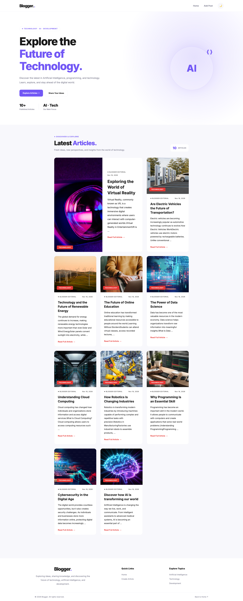
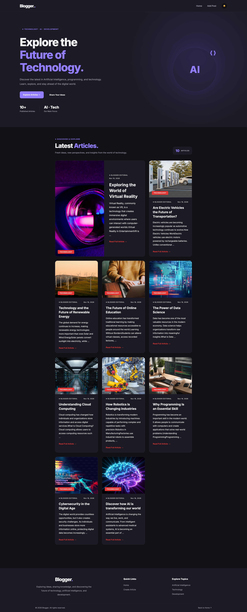
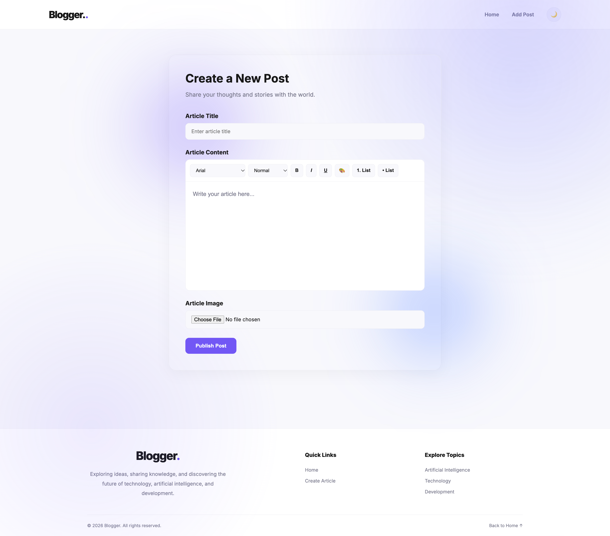
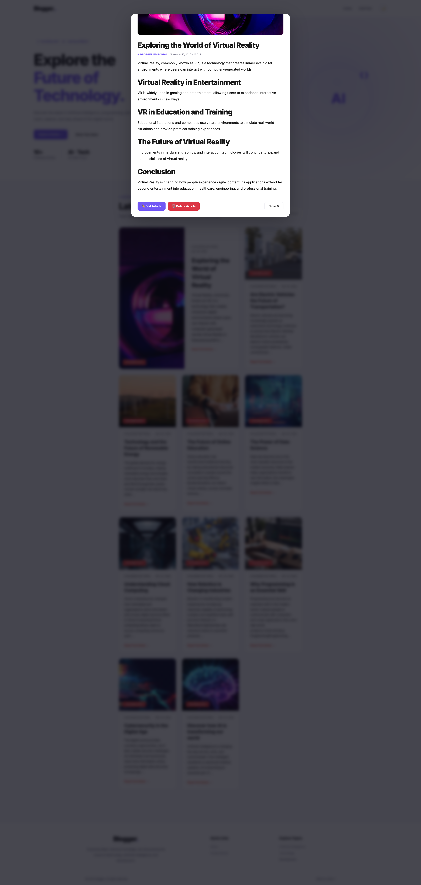

# 📝 Blogger — Technology Blog

A modern and responsive technology blog website built with **Django**, allowing users to create, manage, and explore technology articles.

## ✨ Features

- 🏠 **Homepage** — Modern editorial layout with a featured article.
- ✍️ **Create Posts** — Publish articles with titles, content, and images.
- 🖼️ **Image Uploads** — Attach images to blog posts.
- 📝 **Rich Text Editor** — Format articles with bold, italic, underline, headings, and lists.
- 📖 **Article Details** — Read full articles in a dedicated preview.
- ✏️ **Edit & Delete Posts** — Manage published articles.
- 🌓 **Light & Dark Mode** — Switch between light and dark themes.
- 📱 **Responsive Design** — Optimized for desktop, tablet, and mobile devices.
- 🔒 **HTML Sanitization** — Clean article content using Bleach.

## 🛠️ Built With

- Python
- Django
- HTML5
- CSS3
- JavaScript
- SQLite
- Pillow
- Bleach

## 📸 Screenshots

### 🏠 Homepage — Light Mode



### 🌙 Homepage — Dark Mode



### ✍️ Add New Post



### 📖 Post Details



## 🚀 Getting Started

### 1. Clone the Repository

```bash
git clone https://github.com/iimustafa/LAB-ORM-1.git
```

### 2. Navigate to the Project Directory

```bash
cd LAB-ORM-1/Blogger
```

### 3. Create a Virtual Environment

```bash
python -m venv venv
```

### 4. Activate the Virtual Environment

**macOS / Linux:**

```bash
source venv/bin/activate
```

**Windows:**

```bash
venv\Scripts\activate
```

### 5. Install Dependencies

```bash
pip install django pillow bleach
```

### 6. Apply Database Migrations

```bash
python manage.py migrate
```

### 7. Run the Development Server

```bash
python manage.py runserver
```

### 8. Open the Website

Visit:

```text
http://127.0.0.1:8000/
```

## 📂 Project Structure

```text
LAB-ORM-1/
│
├── Blogger/
│   │
│   ├── Blogger/
│   │   ├── __init__.py
│   │   ├── settings.py
│   │   ├── urls.py
│   │   ├── asgi.py
│   │   └── wsgi.py
│   │
│   ├── BlogApp/
│   │   ├── migrations/
│   │   │
│   │   ├── static/
│   │   │   └── BlogApp/
│   │   │       ├── css/
│   │   │       │   └── style.css
│   │   │       └── images/
│   │   │           └── screenshot/
│   │   │               ├── HomeLight.png
│   │   │               ├── HomeDark.png
│   │   │               ├── AddPost.png
│   │   │               └── PostDetails.png
│   │   │
│   │   ├── templates/
│   │   │   └── BlogApp/
│   │   │       ├── add_post.html
│   │   │       ├── base.html
│   │   │       ├── delete_post.html
│   │   │       ├── edit_post.html
│   │   │       ├── home.html
│   │   │       └── post_detail.html
│   │   │
│   │   ├── templatetags/
│   │   ├── __init__.py
│   │   ├── admin.py
│   │   ├── apps.py
│   │   ├── forms.py
│   │   ├── models.py
│   │   ├── tests.py
│   │   ├── urls.py
│   │   └── views.py
│   │
│   ├── media/
│   ├── db.sqlite3
│   └── manage.py
│
└── README.md
```

## 👨‍💻 Project Information

**Project:** Blogger — Technology Blog  
**Framework:** Django  
**Type:** Django Assignment  
**Repository:** [LAB-ORM-1](https://github.com/iimustafa/LAB-ORM-1)

---

© 2026 **Mustafa Al Ali**. All Rights Reserved.
